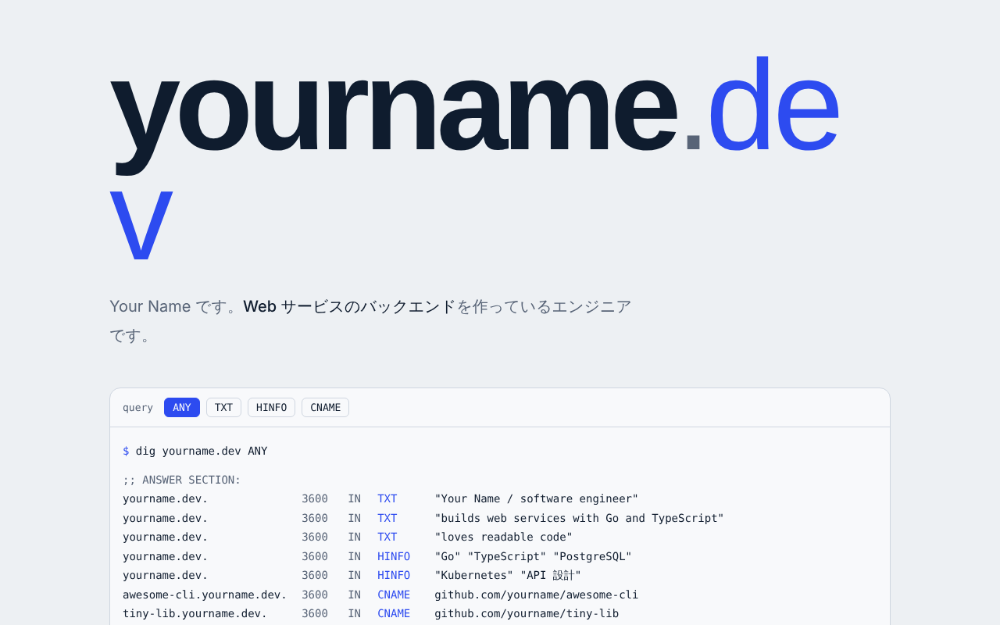

# page-templates

自己紹介ページの静的サイトテンプレート集です。好きなデザインを選び、`profile.js` を自分の内容に書き換えるだけで公開できます。ビルドは不要です。

## デザイン一覧

| デザイン | 説明 | プレビュー |
| --- | --- | --- |
| [dig](themes/dig/) | 自己紹介を `dig` コマンドの応答に見立てるデザイン。エンジニア向け |  |

## 使い方

1. 右上の **Use this template** から自分のリポジトリを作る（またはダウンロードする）
2. `themes/` から使いたいデザインのフォルダを選ぶ
3. そのフォルダの `profile.js` を自分の内容に書き換える
4. `index.html` をブラウザで開いて確認する
5. フォルダの中身をそのまま静的ホスティングに置いて公開する

`profile.js` の書き方は全デザイン共通です。デザインを乗り換えるときは、`profile.js` をそのまま別のデザインのフォルダにコピーすれば使えます。項目の詳細は [docs/profile.md](docs/profile.md) を参照してください。

## 公開する（ロリポップ！デプロイナウの例）

Node.js 22.12.0 以上が必要です。

```bash
npm install -g lolipop
cd themes/dig
lolipop deploy --name <プロジェクト名> --framework static
```

独自ドメインを使う場合:

```bash
lolipop domain create yourname.dev
# 表示された ALIAS / CNAME レコードを DNS に登録してから
lolipop domain verify yourname.dev
```

ほかのホスティング（GitHub Pages など）でも、フォルダの中身を置くだけで動きます。

## デザインを追加する

新しいデザインは `themes/<名前>/` に追加します。手順と決まりごとは [docs/adding-a-theme.md](docs/adding-a-theme.md) を参照してください。

## ライセンス

MIT License。詳しくは [LICENSE](LICENSE) を参照してください。
